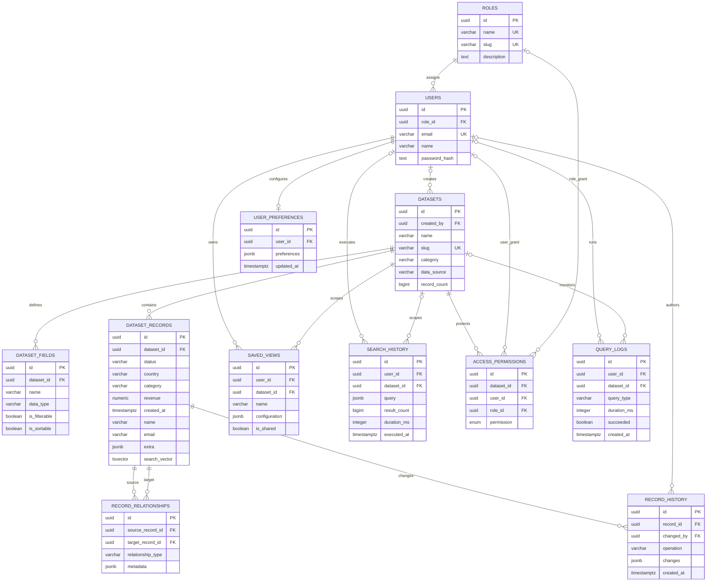

# Database entity-relationship diagram

The diagram reflects the Drizzle schema. Record payloads have typed columns
for common filters and a JSONB `extra` object for additional generated fields.
The search vector is generated from selected typed record columns.

`ACCESS_PERMISSIONS` has a database check requiring exactly one grantee
(`user_id` or `role_id`). `RECORD_RELATIONSHIPS` rejects self-links and uses a
unique constraint over source, target, and relationship type.
