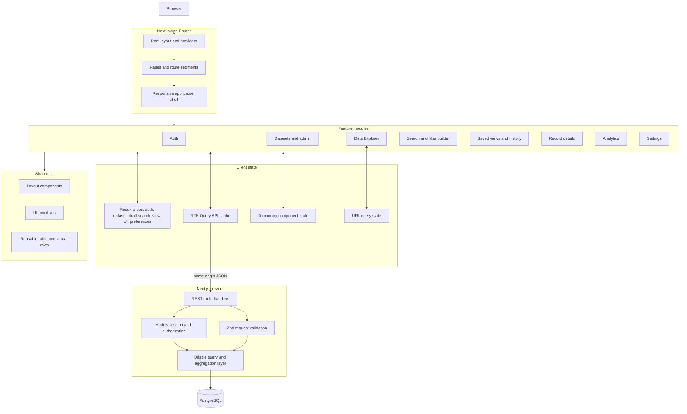

# Frontend architecture

The UI is divided by product feature. App Router files define navigation and
route boundaries; feature modules own domain components and server helpers;
shared libraries provide the API, authentication, and database infrastructure.

## Extension boundaries

- Add a route or page composition in `src/app`.
- Put domain UI and feature-specific server code in `src/features/<feature>`.
- Put shared presentation primitives in `src/components/ui` and application
  navigation/layout components in `src/components/layout`.
- Add shared API endpoints and response types in `src/lib/api`.
- Keep shared Drizzle schema/client code in `src/lib/db`; authorization helpers
  belong in `src/lib/auth`.
- Add global client state only when multiple features need it. Keep remote data
  in RTK Query, and do not copy record pages into a normal Redux slice.

This keeps feature additions cohesive while preserving a single API boundary
for authentication, validation, and database access.
