# Search architecture

```mermaid
flowchart LR
  User[User input]
  Debounce[400 ms global-search debounce]
  Builder[Typed visual filter builder]
  URL[URL state: search, conditions, sort, page, pageSize]
  RTK[RTK Query: deduplicate/cache request]
  Route["GET/POST /api/datasets/{id}/records"]
  Validate[Zod validation and field/operator whitelist]
  Access[Session and dataset permission check]
  Query[Drizzle parameterized SQL builder]
  CountCache[30 s in-process count cache by filter hash]
  Count[Filtered COUNT query on cache miss]
  Page[ORDER BY and LIMIT/OFFSET page query]
  FTS[Generated English tsvector / GIN]
  Trgm[Name ILIKE / pg_trgm GIN]
  PG[(PostgreSQL)]
  History[search_history and query_logs]
  Result[Page, total, hasMore]

  User --> Debounce
  User --> Builder
  Debounce --> URL
  Builder --> URL
  URL --> RTK
  RTK --> Route
  Route --> Validate
  Validate --> Access
  Access --> Query
  Query --> CountCache
  CountCache -->|miss| Count
  Count --> PG
  Count --> CountCache
  Query --> Page
  Query --> FTS
  Query --> Trgm
  FTS --> PG
  Trgm --> PG
  Page --> PG
  PG --> Page
  Page --> Result
  CountCache --> Result
  Route --> History
  Result --> RTK
  RTK --> User
```

## Query rules

1. The browser sends the dataset ID and a search configuration; it never
   downloads all records for local filtering.
2. The API validates the dataset UUID, authenticated user, Zod request schema,
   field whitelist, operator/value compatibility, sort whitelist, page number,
   and page-size limit before query execution.
3. Authorization is checked on the server for every dataset request. Admins
   have platform-wide dataset access; Analyst and Viewer requests also require
   grants sufficient for the requested permission.
4. `buildQuery` binds filter and search values through Drizzle SQL fragments.
   Conditions are combined with `AND`; sort columns come from an allowlist.
5. Global search uses `search_vector @@ plainto_tsquery('english', ...)`.
   `contains` uses escaped `ILIKE` patterns; the `name` column has a
   `gin_trgm_ops` index. The current schema does not add trigram indexes for
   every text field.
6. Results use deterministic sorting (an ID tie-breaker), offset pagination,
   and `pageSize + 1` rows to determine `hasMore`. A filtered count is cached
   for 30 seconds using dataset, global search, and canonicalized conditions;
   sort/page do not affect that count key.
7. Successful non-empty searches are appended to search history (capped at 50
   per user) and query duration/success metadata is recorded in `query_logs`.
   Empty unfiltered queries return an empty response rather than scanning the
   dataset.

## Search trade-offs

PostgreSQL full-text search handles token-oriented global search, while
trigrams support indexed substring matching on names. Both share the
transactional database and dataset access model. See
[ADR 0005](./decisions/0005-postgresql-text-search.md) for alternatives and
scale limits.
